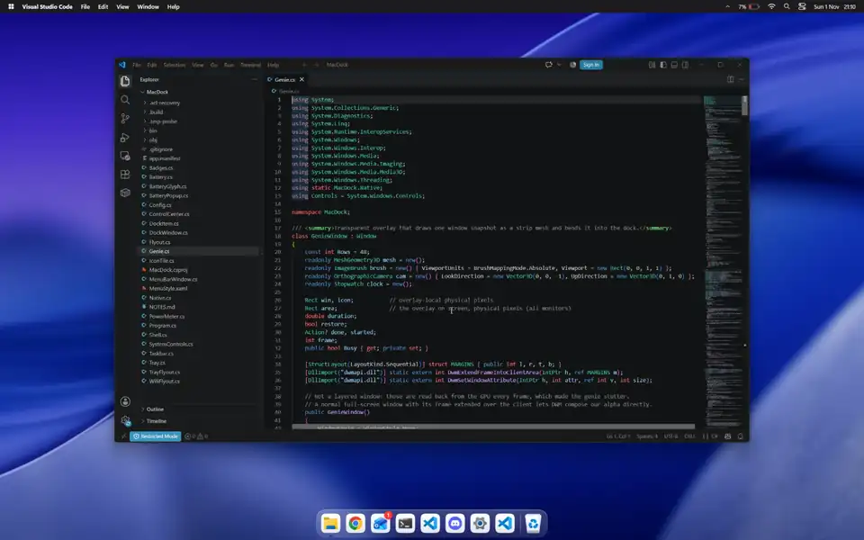
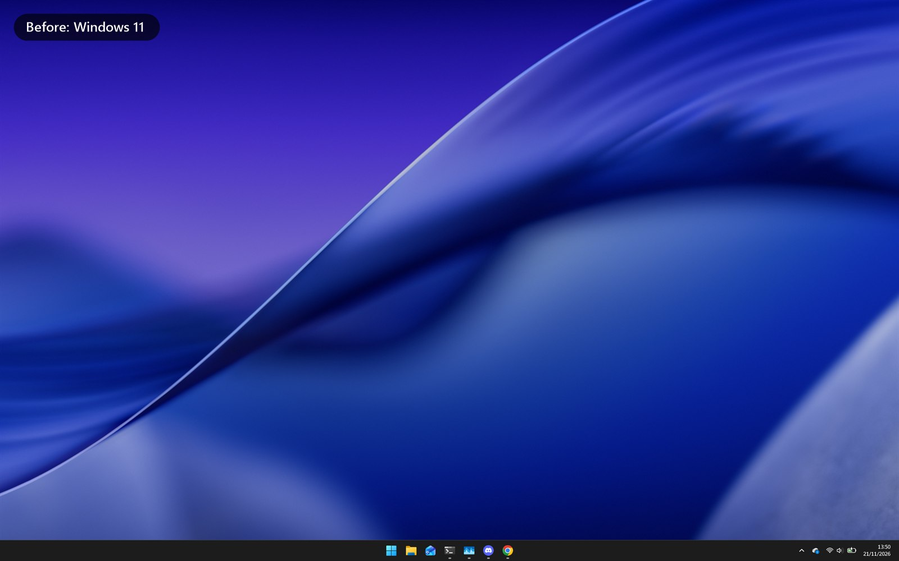
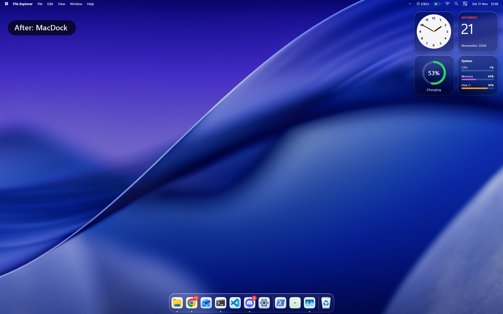
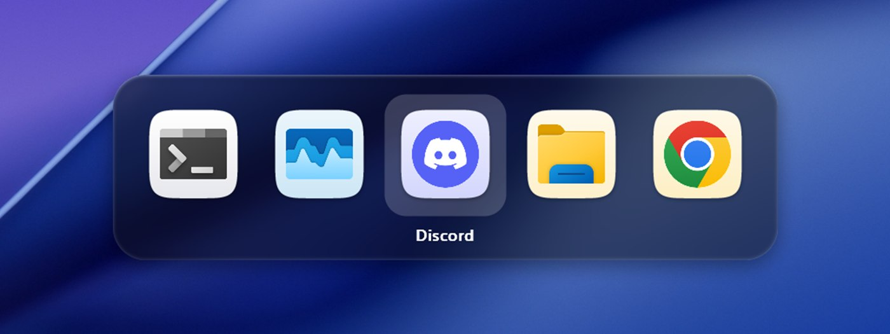
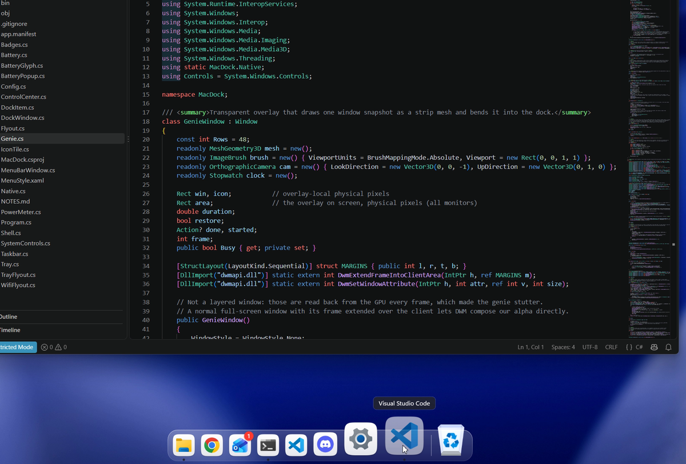
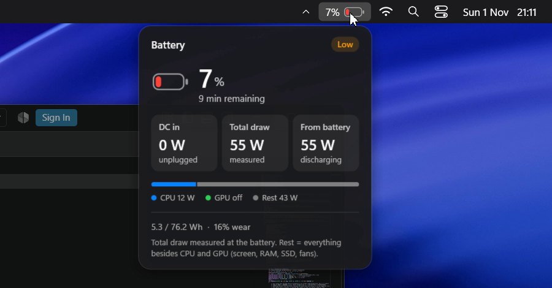
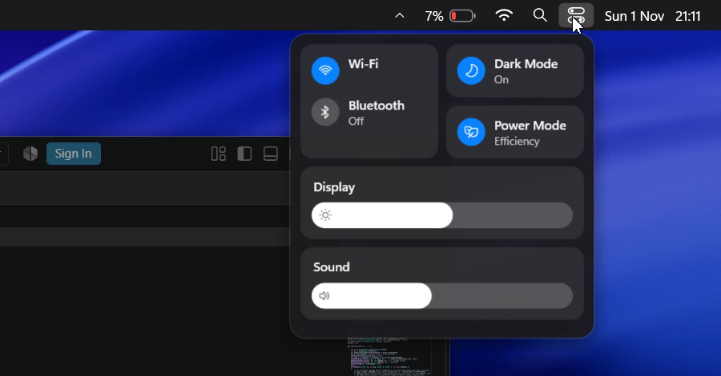
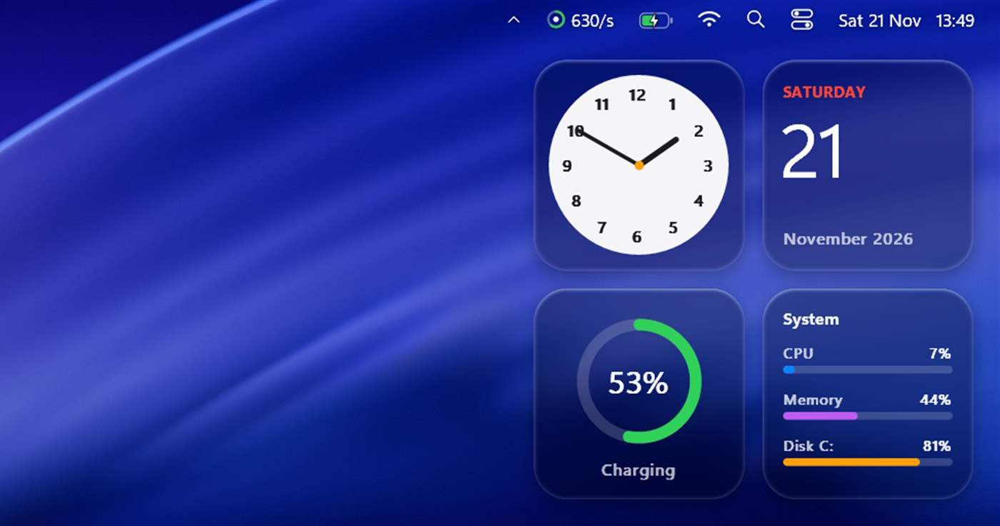

<div align="center">

# MacDock

**A macOS-style dock and menu bar for Windows 11.**
Written from scratch in Rust on plain Win32. No Windhawk, no Explorer patching.



<sub>Every shot is a frame of one screen recording on a Windows 11 laptop. Full quality: <a href="docs/macdock.mp4">docs/macdock.mp4</a></sub>

<br>


</div>

---

## Before and after

Same laptop, same wallpaper, a minute apart.

<table>
<tr>
<td width="50%"></td>
<td width="50%"></td>
</tr>
<tr>
<td align="center"><sub>Windows 11, stock taskbar</sub></td>
<td align="center"><sub>MacDock: menu bar, desktop widgets, Liquid Glass dock</sub></td>
</tr>
</table>

## New in this round

| | |
| --- | --- |
| **Apps window** | macOS 26's replacement for Launchpad: a Liquid Glass window with a search field that has the typing at once, category chips, recent apps and every installed app. The Apps icon in the dock or the menu bar opens it; the full-screen Launchpad is still there in Settings |
| **Spotlight** | The menu bar's magnifier or **Alt+Space**: a glass capsule that grows into results as you type, apps first, then a web search |
| **Settings window** | A floating Mac-style window with traffic lights for every option, animation speeds included, in English or Indonesian |
| **Liquid Glass dock** | The plate shows the real windows behind it (live capture), bent at the rim like macOS 26, not a blurred wallpaper copy |
| **Alt+Tab like Cmd+Tab** | One icon per app, most recent first, on a dark frosted panel. A quick tap flips to the previous app without the panel |
| **Drop files, widgets, recents** | Files dropped on an app icon open in it, on the Trash they are recycled; desktop widgets; the last 3 apps and a Downloads stack by the Trash |



## What you get

<table>
<tr>
<td width="50%" valign="top">

### The dock


- **Magnification** that follows the pointer (cosine falloff, smoothed per frame)
- **Genie** minimize into the app's icon, and back out on restore
- Launch **bounce**, and an attention bounce when an app flashes for you
- Running dots, hover labels and red **unread badges**
- Drag to reorder, drag out to remove, right-click for windows, Keep in Dock, Show in Explorer and Quit
- **Auto-hide**, and icons shrink once the dock reaches the screen edges
- Icons sit on macOS-style squircle tiles; right-click → **Change Icon…** picks your own image
- **Drop files** on an app icon to open them with it, or on the Trash to recycle them
- **Recent apps** (the last 3 you quit) after a divider, and a **Downloads stack** next to the Trash

</td>
<td width="50%" valign="top">

### The genie


The window you minimize is snapshotted at full resolution and drawn on the GPU as a 128-row mesh (Direct3D 11,
4x MSAA, mipmapped), with rounded corners and a soft shadow like the real window, then squeezed and poured into
its icon. Every frame is timed to the display's refresh, so it steps evenly at 144 Hz. When the dock minimizes
or restores all of an app's windows, each one gets its own genie, cascading into (and out of) the icon. Restore
from the dock plays it backwards and dissolves into the real window. Windows' own minimize animation is
switched off while MacDock runs and comes back when it quits.

</td>
</tr>
<tr>
<td width="50%" valign="top">

### Battery, with real numbers


Charge, time left, wear and cycles, plus where the power goes: CPU package power from Windows' energy
meter (RAPL, no admin), NVIDIA GPU power from NVML, and the rest. On battery the total is measured; on
the adapter it is estimated from a "rest" value MacDock learns while you are unplugged.

</td>
<td width="50%" valign="top">

### Control Center


Wi-Fi and Bluetooth radios, Dark Mode, Windows power mode, brightness and volume, plus now-playing
media. Next to it: a Wi-Fi menu that scans and joins networks, and a `^` item that hosts your
notification-area icons (Discord, Steam, …).

</td>
</tr>
</table>

### The menu bar

- The app in front, in bold, with **File / Edit / View / Window / Help** menus that send the real
  shortcuts (Ctrl+S, Ctrl+Z, …) to that app
- System menu with Automatically Hide Dock, Quit MacDock and **Check for MacDock Updates…**. MacDock asks
  GitHub for the latest release at start and every 6 hours (only `api.github.com`, nothing is downloaded by
  itself); when a newer one is out, a blue dot sits on the logo and the menu shows **Update Available**, which
  opens the release page
- Battery, Wi-Fi, **Spotlight** search, Control Center and the clock, which drops a **calendar** (month view, arrows or the
  wheel step months, rows for the notification center and date & time settings)
- **AI usage** for Claude Code and Codex: a ring with the limit closest to running out and the live
  burn rate in tok/s. Its flyout shows tok/s over 5 and 30 minutes, the last 24 hours, each limit with the
  points used per 5 / 30 minutes, when the current pace would hit it, and every session that burned
  tokens in the last 30 minutes (title, project, model, branch, its own tok/s). Read from the agents' local logs
  (`~/.claude/projects`, `~/.codex/sessions`); by default nothing is sent anywhere. Codex reports its own limits.
  Claude Code logs none: turn on `ClaudeUsageOAuth` to read its real 5-hour and weekly limits from Anthropic
  with Claude Code's own login (every 2 minutes, only to api.anthropic.com; MacDock never refreshes the token),
  or set `ClaudeLimit5h` for an estimate from local tokens.

### Alt+Tab, the macOS way

- Hold Alt and press Tab (Shift+Tab or the arrow keys go back), release Alt to switch. One icon per app,
  not per window, most recently used first, with the app's name under the selection
- **Esc** cancels, **Q** quits the selected app, **H** minimizes it; the mouse selects on hover and switches on click
- A quick tap switches to the previous app without ever showing the panel
- Runs on its own thread with a low-level keyboard hook, so the dock never makes it lag. Turn it off with
  `"AppSwitcher": false` to get the Windows switcher back

### Desktop widgets




- Four small macOS-style widgets at the top right of the desktop: an analog clock, today's date, a battery
  ring and CPU / memory / disk bars, on frosted Liquid Glass made from your wallpaper
- They live under every window, like on macOS; a click opens Clock, Calendar, battery settings or Task Manager
- Redrawn every 5 seconds, and only when a value on them changed

### It stays out of the way

- Dock and menu bar are real **AppBars**: maximized windows stop at them.
- A fullscreen game hides both, puts the render loop to sleep and removes the mouse hook. On the
  author's laptop that measured 0.00% CPU and a 17 MB working set while a game was in front.
- Idle on the desktop: 0.03% of the CPU (about 1% of one core) and about 90 MB private memory. Most of that
  memory is the one Direct3D device the live Liquid Glass and the GPU genie share (the Intel iGPU driver alone
  reserves ~50 MB for it); the 13 MB of 0.1 had no live glass. Nothing redraws unless something is moving
  (see [Performance](#performance)).

## Install

**Download:** grab `macdock.exe` from the [latest release](https://github.com/GodrezJr2/MacDock/releases/latest)
and run it. Windows 11 only, nothing else to install. Each release is built by GitHub Actions from its tag;
what changed in each version is in [CHANGELOG.md](CHANGELOG.md).

**Build from source:** you need Windows 11 and Rust. Follow these steps in order:

1. Install Rust from [rustup.rs](https://rustup.rs) (run `rustup-init.exe`, accept the defaults).
2. Switch to the GNU toolchain, so you don't need Visual Studio Build Tools:
   ```powershell
   rustup default stable-x86_64-pc-windows-gnu
   ```
3. Open a new terminal, then build and run:
   ```powershell
   git clone https://github.com/GodrezJr2/MacDock.git
   cd MacDock
   cargo build --release
   .\target\release\macdock.exe
   ```

The first build takes a few minutes because it compiles the dependencies.

The result is one ~1.7 MB exe with no runtime to install; copy it wherever you like.

MacDock hides the Windows taskbar while it runs and restores it when you quit.

- **Quit:** Windows logo in the menu bar → **Quit MacDock**
- **If it was killed** and the taskbar is still hidden: `macdock.exe --restore`
- **Start with Windows:** Windows logo in the menu bar → **Open MacDock at Login**

## Configure

Settings live in `%APPDATA%\MacDock\config.json`, created on first run.

| Key | Default | What it does |
| --- | --- | --- |
| `Pinned` | Explorer, Apps, Chrome, Outlook, Terminal, VS Code, Discord, Settings | Dock items: `shell:AppsFolder\<AppID>`, a `.lnk`, an `.exe`, or `macdock:apps` for the Apps item |
| `LaunchpadStyle` | `"apps"` | What the Apps icon opens: `"apps"` (the macOS 26 Apps window) or `"classic"` (full-screen Launchpad) |
| `IconSize` | `52` | Icon size at rest, in pixels |
| `Magnify` | `1.75` | Size of the icon under the pointer, relative to rest |
| `AutoHide` | `false` | Slide the dock away until the pointer touches the bottom edge |
| `Genie` | `true` | Genie minimize and restore |
| `IconTiles` | `true` | Put every icon on a squircle tile |
| `Badges` | `true` | Red unread badges |
| `MenuBar` | `true` | Show the menu bar |
| `TrayIcons` | `true` | Host notification-area icons behind the `^` item |
| `HideTaskbar` | `true` | Hide the Windows taskbar while MacDock runs |
| `DesktopWidgets` | `true` | Clock, date, battery and system widgets on the desktop |
| `DownloadsStack` | `true` | Downloads folder item next to the Trash |
| `SecondaryDocks` | `true` | Show docks on secondary monitors (also toggleable in Settings) |
| `DownloadsFolder` | your Downloads | Folder the stack lists, if it is not the Windows Downloads folder |
| `ShowRecents` | `true` | The last 3 apps you quit, after a divider |
| `AppSwitcher` | `true` | macOS-style Alt+Tab (off = the Windows switcher) |
| `IconOverrides` | `{}` | Item → image or exe used as its icon (set with right-click → Change Icon…) |
| `AiUsage` | `true` | Claude Code / Codex usage item in the menu bar (shown once either has logs) |
| `ClaudeUsageOAuth` | `false` | Read Claude's real 5-hour / weekly limits from `api.anthropic.com/api/oauth/usage` with the login in `~/.claude/.credentials.json` |
| `ClaudeLimit5h` | `null` | Tokens per 5-hour Claude block that count as 100% (input + cache writes + output) |

A crash writes `%APPDATA%\MacDock\panic.log` and still puts the taskbar back.

## How it works

<details>
<summary><b>Liquid Glass without a blur API</b></summary>

Windows ignores window regions for layered windows, so accent blur behind a rounded plate showed up as a
black or grey square. MacDock draws the glass itself: the windows under the plate are captured live with
Windows Graphics Capture (one capture per window, wallpaper where there is none), and the plate shows them
nearly sharp, bent inward near the rim like a lens, with a light edge on top. Captures repaint at most 30 times
a second, so a video playing behind the dock costs about 0.1 s of CPU per second.
</details>

<details>
<summary><b>A genie with no flash</b></summary>

For a title-bar minimize, a low-level mouse hook (on its own thread) sees the press on the minimize button
and MacDock pre-draws the first frame from a fresh snapshot; on release the overlay is shown from the hook
itself, so the animation is already up when the window disappears. The mesh is drawn into a DirectComposition
swap chain, and animation time comes from DWM's vblank clock rather than when the frame happened to run, so
no frame lands early or late. Windows covered by others are read with `PrintWindow` (about 12-22 ms each, in
parallel) so a minimize-all can animate them too. Snapshots of minimized windows are saved to disk, so windows
minimized before a restart still animate on restore.
</details>

<details>
<summary><b>Unread badges</b></summary>

The taskbar keeps app badges to itself, so the count is the larger of a `(N)` prefix in the window title
and the Action Center toasts that arrived since you last had the app in front (read from the notification
database through the system's own `winsqlite3.dll`).
</details>

<details>
<summary><b>Battery power on a laptop that does not report it</b></summary>

The battery driver only knows the battery side. On battery its discharge rate is the whole system's draw;
on the adapter nothing measures the input. MacDock reads CPU package energy through Windows' Energy Meter
Interface and GPU power through NVML, and learns the rest (screen, RAM, SSD, fans) while unplugged. Sensors
are read off the UI thread, and a sleeping NVIDIA GPU is left asleep instead of being woken every second.
</details>

## Known limits

- Built and tested on one machine: a Windows 11 laptop at 2560×1600, 125% scale, with an NVIDIA GPU.
  Other setups may show rough edges; issues are welcome.
- The menu bar lives on the primary monitor. Docks appear on secondary monitors when **Docks on secondary monitors** is enabled in Settings; other monitors have no taskbar while MacDock runs.
- While the `^` tray flyout is open, a WinUI 3 app started at that moment can fail to start, because the
  tray host registers its own `Shell_TrayWnd`. The host only runs while that flyout is open.
- GPU power needs an NVIDIA GPU; without one the breakdown shows CPU and the rest.

## Performance

MacDock started as C# / WPF on .NET 10 and was rewritten in Rust (plain Win32, tiny-skia, WinRT through the
`windows` crate) to make it lighter. Measured on the same laptop (32 logical cores, on AC power): a fresh start,
20 s idle, then a 10 s scripted pointer sweep over the dock. CPU is a share of the whole machine, as Task
Manager shows it; with 32 cores that number is small, so the brackets give the same load as a share of one core
(on a 4-core laptop, Task Manager would show about 8 times the first number).

| | C# / WPF | Rust 0.1 | Rust 0.4.2 |
| --- | --- | --- | --- |
| Private memory | 320-379 MB | 12.9 MB | 91.7 MB |
| CPU idle | 0.04-0.6% (1-19% of a core) | 0% | 0.03% (1% of a core) |
| CPU while magnifying | 2.0-2.3% (64-74% of a core) | 1.65% (53% of a core) | 1.38% (44% of a core) |
| Threads | 21-26 | 11 | 38 |
| On disk | 30 MB + .NET runtime | 1.1 MB exe | 1.66 MB exe |

0.4.2 does a lot more than 0.1: live Liquid Glass and the GPU genie (one Direct3D device, most of the memory),
the Alt+Tab switcher and its keyboard hook, desktop widgets, the Apps window and Spotlight. Each of those that
waits on Windows runs on its own thread, which is where the extra threads come from.

The genie, from `genie.log` on a 144 Hz panel with a 1920x960 window: a minimize runs 68-78 frames at 7.0-7.9 ms
apart on average, and presenting a frame costs the CPU about 0.1 ms (the mesh is drawn on the GPU).

The C# version is kept at the tag [`csharp-final`](https://github.com/GodrezJr2/MacDock/tree/csharp-final).

## Credits

- Built by [@GodrezJr2](https://github.com/GodrezJr2) with Claude Code as an AI pair programmer.
- macOS and the Dock are trademarks of Apple Inc. MacDock is an independent project, not affiliated with or endorsed by Apple.

## License

[MIT](LICENSE)
