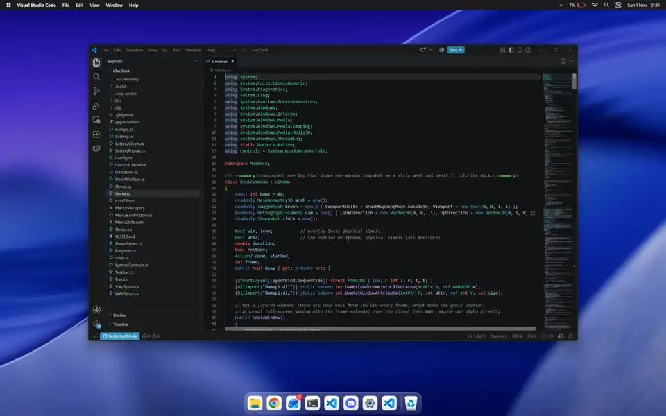
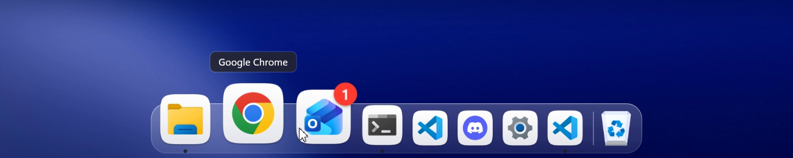
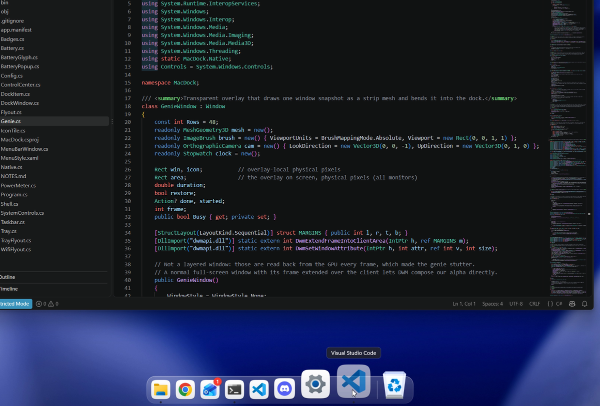
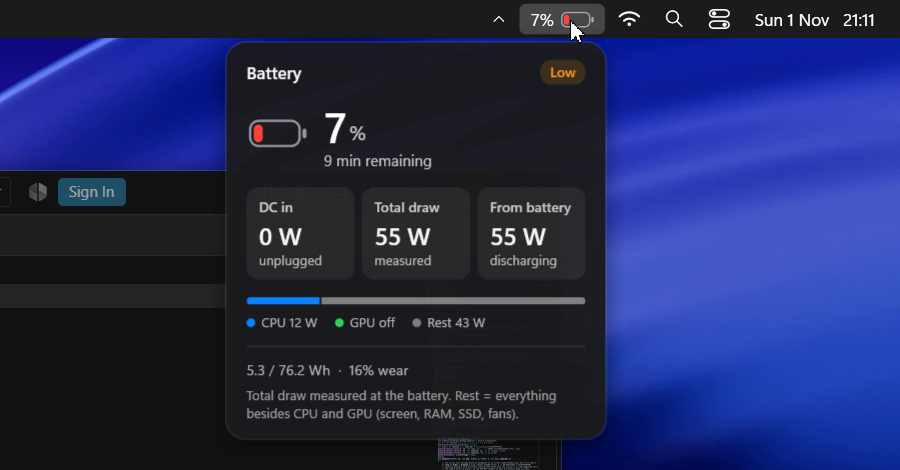
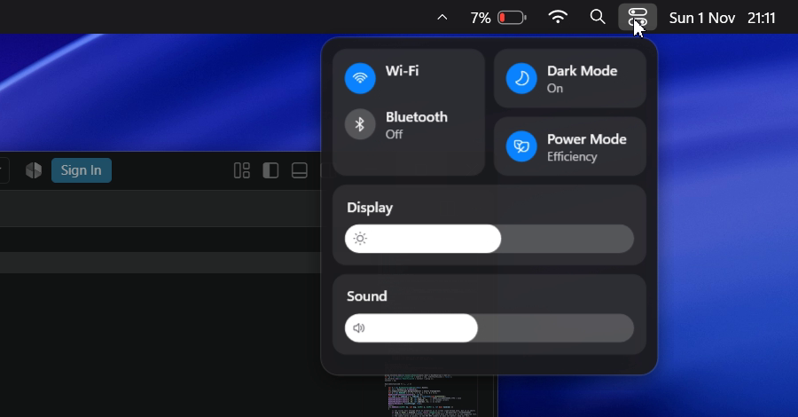

<div align="center">

# MacDock

**A macOS-style dock and menu bar for Windows 11.**
Written from scratch in C# / WPF on .NET 10. No Windhawk, no Explorer patching.



<sub>Every shot is a frame of one screen recording on a Windows 11 laptop. Full quality: <a href="docs/macdock.mp4">docs/macdock.mp4</a></sub>

<br>


</div>

---

## What you get

<table>
<tr>
<td width="50%" valign="top">

### The dock


- **Magnification** that follows the pointer (cosine falloff, smoothed per frame)
- **Genie** minimize into the app's icon, and back out on restore
- Launch **bounce**, and an attention bounce when an app flashes for you
- Running dots, hover labels and red **unread badges**
- Drag to reorder, drag out to remove, right-click for windows, Keep in Dock, Show in Explorer and Quit
- **Auto-hide**, and icons shrink once the dock reaches the screen edges
- Icons sit on macOS-style squircle tiles

</td>
<td width="50%" valign="top">

### The genie


The window you minimize is snapshotted and drawn as a 48-row mesh in a `Viewport3D` overlay, then
squeezed and poured into its icon. Restore from the dock plays it backwards. Windows' own minimize
animation is switched off while MacDock runs and comes back when it quits.

</td>
</tr>
<tr>
<td width="50%" valign="top">

### Battery, with real numbers


Charge, time left, wear and cycles, plus where the power goes: CPU package power from Windows' energy
meter (RAPL, no admin), NVIDIA GPU power from NVML, and the rest. On battery the total is measured; on
the adapter it is estimated from a "rest" value MacDock learns while you are unplugged.

</td>
<td width="50%" valign="top">

### Control Center


Wi-Fi and Bluetooth radios, Dark Mode, Windows power mode, brightness and volume, plus now-playing
media. Next to it: a Wi-Fi menu that scans and joins networks, and a `^` item that hosts your
notification-area icons (Discord, Steam, …).

</td>
</tr>
</table>

### The menu bar

- The app in front, in bold, with **File / Edit / View / Window / Help** menus that send the real
  shortcuts (Ctrl+S, Ctrl+Z, …) to that app
- System menu with Automatically Hide Dock and Quit MacDock
- Battery, Wi-Fi, search, Control Center and the clock (which opens the notification center)

### It stays out of the way

- Dock and menu bar are real **AppBars**: maximized windows stop at them.
- A fullscreen game hides both, puts the render loop to sleep and removes the mouse hook. On the
  author's laptop that measured 0.00% CPU and a 17 MB working set while a game was in front.
- Idle on the desktop: about 2.5% of one core and ~230 MB, because the dock only redraws while
  something is moving.

## Install

You need Windows 11 and the [.NET 10 SDK](https://dotnet.microsoft.com/download).

```powershell
git clone https://github.com/GodrezJr2/MacDock.git
cd MacDock
dotnet build -c Release
.\bin\Release\net10.0-windows\MacDock.exe
```

MacDock hides the Windows taskbar while it runs and restores it when you quit.

- **Quit:** Windows logo in the menu bar → **Quit MacDock**
- **If it was killed** and the taskbar is still hidden: `MacDock.exe --restore`
- **Start with Windows:** put a shortcut to `MacDock.exe` in `shell:startup`

## Configure

Settings live in `%APPDATA%\MacDock\config.json`, created on first run.

| Key | Default | What it does |
| --- | --- | --- |
| `Pinned` | Explorer, Chrome, Outlook, Terminal, VS Code, Discord, Settings | Dock items: `shell:AppsFolder\<AppID>`, a `.lnk` or an `.exe` |
| `IconSize` | `52` | Icon size at rest, in pixels |
| `Magnify` | `1.75` | Size of the icon under the pointer, relative to rest |
| `AutoHide` | `false` | Slide the dock away until the pointer touches the bottom edge |
| `Genie` | `true` | Genie minimize and restore |
| `IconTiles` | `true` | Put every icon on a squircle tile |
| `Badges` | `true` | Red unread badges |
| `MenuBar` | `true` | Show the menu bar |
| `TrayIcons` | `true` | Host notification-area icons behind the `^` item |
| `HideTaskbar` | `true` | Hide the Windows taskbar while MacDock runs |

Errors go to `%APPDATA%\MacDock\error.log`.

## How it works

<details>
<summary><b>The frosted dock without a blur API</b></summary>

Windows ignores window regions for layered windows, so accent blur behind a rounded plate showed up as a
black or grey square. The plate is instead painted with a blurred slice of your wallpaper, mapped to its
position on screen. Because the dock is an AppBar, the wallpaper is almost always what sits behind it.
</details>

<details>
<summary><b>A genie with no flash</b></summary>

The overlay is one full-screen window that stays DWM-cloaked until it is needed, so it never takes clicks.
For a title-bar minimize, a low-level mouse hook sees the press on the minimize button, takes a fresh
snapshot and draws it into the hidden overlay; on release the overlay uncloaks over the window, so the
animation is already up when the window disappears. Snapshots are shrunk off the UI thread and saved to
disk, so windows minimized before a restart still animate on restore.
</details>

<details>
<summary><b>Unread badges</b></summary>

The taskbar keeps app badges to itself, so the count is the larger of a `(N)` prefix in the window title
and the Action Center toasts that arrived since you last had the app in front (read from the notification
database through the system's own `winsqlite3.dll`).
</details>

<details>
<summary><b>Battery power on a laptop that does not report it</b></summary>

The battery driver only knows the battery side. On battery its discharge rate is the whole system's draw;
on the adapter nothing measures the input. MacDock reads CPU package energy through Windows' Energy Meter
Interface and GPU power through NVML, and learns the rest (screen, RAM, SSD, fans) while unplugged. Sensors
are read off the UI thread, and a sleeping NVIDIA GPU is left asleep instead of being woken every second.
</details>

## Known limits

- Built and tested on one machine: a Windows 11 laptop at 2560×1600, 125% scale, with an NVIDIA GPU.
  Other setups may show rough edges; issues are welcome.
- The dock sits at the bottom of the primary monitor.
- While the `^` tray flyout is open, a WinUI 3 app started at that moment can fail to start, because the
  tray host registers its own `Shell_TrayWnd`. The host only runs while that flyout is open.
- GPU power needs an NVIDIA GPU; without one the breakdown shows CPU and the rest.

## Credits

- Tray icon hosting uses [ManagedShell](https://github.com/cairoshell/ManagedShell), the library behind RetroBar and Cairo.
- Built by [@GodrezJr2](https://github.com/GodrezJr2) with Claude Code as an AI pair programmer.
- macOS and the Dock are trademarks of Apple Inc. MacDock is an independent project, not affiliated with or endorsed by Apple.

## License

[MIT](LICENSE)
